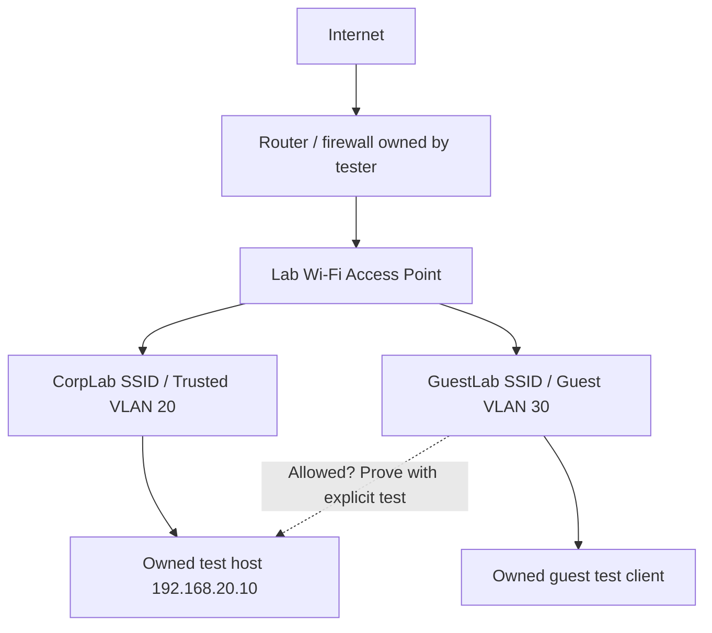

# Wireless Security Assessment | Authorised Lab Portfolio

[](#run-the-tools)  

**Purpose:** Demonstrate a repeatable, evidence-led Wi-Fi security assessment workflow: scoping, reviewing access point (AP) settings, testing guest isolation on a network I control, documenting potential issues, providing remediation advice and retesting.

> **Transparency:** This repository includes a **synthetic demonstration inventory and example report**. They are *not evidence of a completed customer engagement*. Real test observations and confirmed findings must be added only after authorised lab work. The automated controls review is an aid to assessment, not a wireless scanner or proof of exploitation.

## Why this project?

Wireless environments depend on authentication, encryption, management-frame protection, AP administration and segmentation. This portfolio maps each reviewed control to evidence and an actionable recommendation, then separates **configuration concerns** from **confirmed vulnerabilities**.

## Lab topology



- Use only hardware or VMs you own or have **written authorisation** to assess.
- No attacks against neighbours' networks; no password cracking, deauthentication, evil-twin or interference techniques are required.
- The connectivity check tests **one approved private IP/port at a time**, from a device connected to your **guest** SSID.

## Assessment objectives

| ID | Control | Evidence and validation approach |
| --- | --- | --- |
| WS-01 | WPA2/WPA3 mode and ciphers | AP configuration export or redacted screenshot; assess supported security mode |
| WS-02 | Protected Management Frames (PMF/802.11w) | AP setting and client compatibility; PMF should be enabled; required as part of WPA3 |
| WS-03 | WPS | Review AP configuration; disable WPS if unnecessary |
| WS-04 | Guest-to-trusted segmentation | Firewall/VLAN review **plus** single-service connectivity test from a guest client |
| WS-05 | AP administration access | Confirm that guest/wireless clients cannot access the AP management interface |
| WS-06 | Firmware maintenance | Record vendor, version and vendor security advisory review date; do not post serial numbers |
| WS-07 | Evidence-to-report traceability | Each finding has scope, observation, verification status, impact, fix and retest |

## Repository structure

```text
Wireless-Security-Assessment/
├── README.md
├── data/
│   └── demo_observations.json          # SYNTHETIC INPUT; not a client export
├── src/
│   ├── wifi_audit.py                   # Offline AP settings reviewer, JSON -> Markdown
│   └── guest_isolation_check.py        # One-target, authorised connectivity validator
├── tests/
│   └── test_wifi_audit.py              # Automated unit tests
├── docs/
│   ├── lab-setup.md                    # Build and execute in an owned lab
│   ├── assessment-scope.md             # Permission/scope/ROE template
│   ├── test-cases.md                   # Test plan and evidence matrix
│   ├── report-template.md              # Professional report framework
│   ├── example-finding-DEMO.md         # Hypothetical finding, not a real result
├── reports/
│   └── demo-assessment-report.md       # Automatically generated from demo JSON
└── .github/workflows/tests.yml         # CI for offline unit tests
```

## Run the tools

Requires **Python 3.10+**, no third-party dependencies.

**1. Review a manually recorded AP configuration (OFFLINE):**

```bash
python3 src/wifi_audit.py --input data/demo_observations.json --output reports/demo-assessment-report.md
```

The input is *fictional*. Read the generated report to see the format. To assess your own AP, copy the JSON to an excluded local file, manually replace the settings with verified observations, and produce a private report. The script does not collect AP credentials or connect to Wi-Fi itself.

**2. Test a single approved guest-to-trusted service (ACTIVE; authorised lab only):**

```bash
# Run ON a device attached to YOUR GuestLab SSID. Replace the IP and port with
# an owned lab destination and a service you intentionally made available.
python3 src/guest_isolation_check.py --target 192.168.20.10 --port 443 \
  --confirm-authorised --confirm-on-guest
```

- **CONNECTED** means the test client could establish a TCP connection to that service. Investigate whether this violates the approved segmentation policy.
- **REFUSED/TIMED OUT** is **not sufficient proof** of correct isolation: the host may simply have no listening service. Establish a trusted-network baseline, check firewall logs and retest.
- The utility rejects non-private IPs, invalid ports and calls without explicit confirmation. It does not discover networks, brute-force or exploit services.

**3. Run automated tests:**

```bash
python3 -m unittest discover -s tests -v
```

## Portfolio evidence to add *after doing the work*

- A redacted screenshot/export of your lab's actual authentication, PMF, WPS and guest/VLAN settings.
- An authorised baseline connection **from a trusted client** to the intended test service, and a test **from a guest client**.
- Firewall log or packet-capture evidence explaining the result, rather than inferring from a timeout.
- A confirmed finding with recommendation and retest (or an explicitly documented clean assessment).
- A short executive summary understandable by a nontechnical customer.

Keep client information, real network identifiers, secrets, MAC addresses, public IPs and proprietary reports out of public repositories.

## Standards and references

- Australian Signals Directorate, [Information Security Manual — Guidelines for networking](https://www.cyber.gov.au/ism/2026-09/guidelines-for-networking) (wireless network controls including ISM-0536, ISM-1315, ISM-1332, ISM-1335).
- Australian Cyber Security Centre, [Small business: remote working security](https://www.cyber.gov.au/publication/small-business-cyber-security-handbook/remote-working-security).

**Notes:** ISM controls can be context-dependent and subject to updates; this small lab is not a claim of formal ISM certification, compliance or a professional penetration test. Severity labels in the demonstration are provisional and not CVSS scores.

## Implementation status and limitations

The offline configuration review script, restricted connectivity check and unit tests are included. The example inventory and generated report are **synthetic**. No live wireless assessment results are claimed by this repository. Add redacted evidence of owned or expressly authorised lab tests once those tests have actually been performed.
